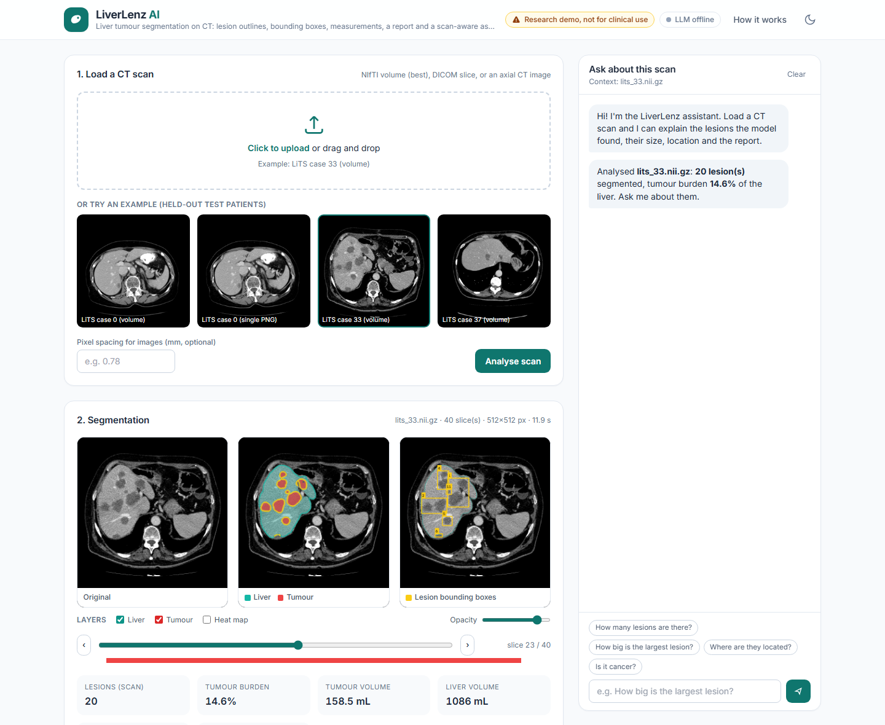
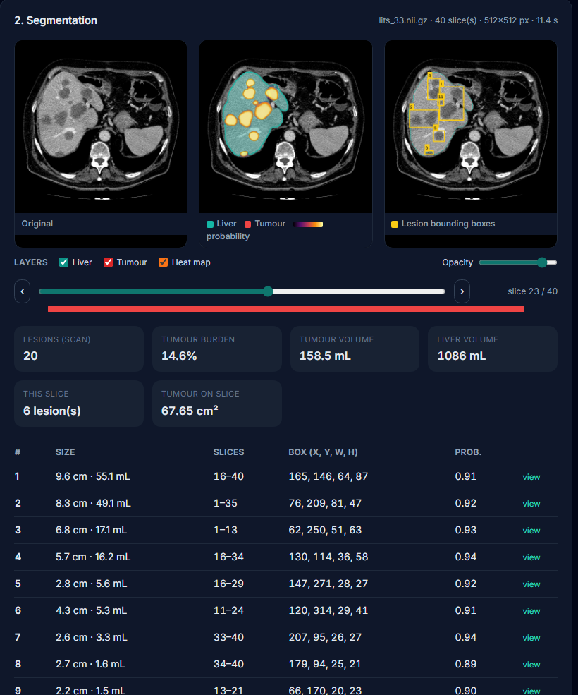
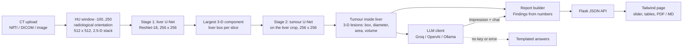

# LiverLenz AI

**Liver tumour segmentation on CT: finds the liver, outlines each lesion, draws its bounding box, measures it, and writes a structured report you can download or discuss with an AI assistant.**

[](https://www.python.org/)
[-005CED.svg)](https://onnxruntime.ai/)
[](notebooks/train_lits_cascade.ipynb)
[](LICENSE)




> **Research demo, not for clinical use.** The model was trained on a public dataset, can miss lesions (especially small ones) and does not classify lesion type.

## Features

- **Upload a real scan**: NIfTI volume (`.nii` / `.nii.gz`), a DICOM slice, or a plain CT image (PNG/JPG). Three held-out test patients are bundled as one-click examples.
- **Two-stage segmentation**: liver first, then tumours inside the liver at higher resolution.
- **Per-lesion results**: outline, bounding box, largest diameter, area and volume (in mm / cm² / mL whenever the scan's pixel spacing is known), slice range and confidence.
- **Volume viewer**: slice slider with lesion markers; original, overlay (liver teal, tumour red) and box views side by side.
- **Structured report** (Findings with a lesion table / Impression / Disclaimer), downloadable as **PDF** or **Markdown**.
- **Chat about the scan**: an OpenAI-compatible LLM (Groq + Llama by default, OpenAI or local Ollama) that sees only the measured statistics. **Works without an API key**: answers then come from templates and the UI shows an "LLM offline" badge.
- **Light and dark mode**, loading states and friendly errors. CPU-only inference with ONNX Runtime (batch size 1), so it runs on any laptop.

<p align="center"></p>

## How it works



| Path | What it does |
|---|---|
| `notebooks/train_lits_cascade.ipynb` | Kaggle GPU notebook: data caching, patient-wise split, both U-Nets, 3-D test evaluation, ONNX export |
| `liverlenz/cascade.py` | Input loading (NIfTI/DICOM/image), the two-stage inference, lesion measurements, rendering |
| `liverlenz/report.py` | Report (Findings / Impression / Disclaimer) and chat, with template fallback |
| `liverlenz/llm.py` | OpenAI-compatible client configured from `.env`; returns `None` when offline |
| `app/` | Flask app (`/api/analyze`, `/api/slice`, `/api/chat`, `/api/examples`, `/api/status`) and the UI |
| `scripts/predict.py` | CLI: segment files and save panels, lesion JSON and a Markdown report |
| `scripts/evaluate.py` | Held-out 3-D test evaluation of the ONNX models (batch size 1, CPU) |
| `scripts/export_onnx.py` | Convert the notebook's PyTorch checkpoints to the ONNX files the app loads |
| `scripts/fetch_msd_examples.py`, `scripts/make_examples.py` | Download test scans / rebuild the bundled examples from the Medical Segmentation Decathlon |
| `docs/AUDIT.md` | What was wrong with the original version, and why the model was replaced |

## Results

RESULTS_PLACEHOLDER

## Quick start

Python 3.10 to 3.12, Windows / macOS / Linux, CPU only.

```bash
git clone https://github.com/Amna05Chaudhry/LiverLenz-AI-Liver-CT-Scan-Analysis.git
cd LiverLenz-AI-Liver-CT-Scan-Analysis
python -m venv .venv && .venv/Scripts/activate        # macOS/Linux: source .venv/bin/activate
pip install -r requirements.txt
python -m app                                          # open http://127.0.0.1:5000
```

Optional, for LLM-written impressions and free-form chat: copy `.env.example` to `.env` and set `LLM_API_KEY` (free key at [console.groq.com](https://console.groq.com/keys)), or point `LLM_BASE_URL` at OpenAI or a local Ollama.

**CLI**

```bash
python scripts/predict.py examples/lits_33.nii.gz --out outputs
```

**Tests**: `pip install -r requirements-dev.txt && pytest -q`

**Retrain**: open [`notebooks/train_lits_cascade.ipynb`](notebooks/train_lits_cascade.ipynb) on Kaggle, add the datasets `andrewmvd/liver-tumor-segmentation` and `andrewmvd/liver-tumor-segmentation-part-2`, choose GPU T4 x2 and *Save & Run All* (about 1 h of data caching and 1 h of training). Copy the ONNX files from the output into `models/`, or convert the checkpoints with `python scripts/export_onnx.py stage1.pt stage2.pt`.

**Re-run the test evaluation** (downloads the 20 test scans, about 2 GB, from the Decathlon mirror):

```bash
python scripts/fetch_msd_examples.py 0 2 3 4 20 24 25 33 37 51 56 68 70 80 90 91 92 101 106 111
python scripts/evaluate.py
```

**Deep links**: `http://127.0.0.1:5000/?example=lits_33.nii.gz&slice=22&heat=1&theme=dark` opens an example at a given slice.

## Input tips

- **NIfTI or DICOM** gives the best results: real Hounsfield units, the right orientation, and sizes in millimetres.
- **Plain images** (PNG/JPG, for example a CT picture from the web) work, but their brightness and contrast are whatever the image used, so results are less reliable. Enter the pixel spacing if you know it, otherwise sizes are in pixels.
- Axial, contrast-enhanced abdominal CT, like LiTS. Other planes, MRI or ultrasound are out of scope.

## Tech stack

Python, PyTorch + segmentation-models-pytorch (training on Kaggle GPU), ONNX Runtime (CPU inference), Flask, NumPy, SciPy, OpenCV, Pillow, nibabel, pydicom, Tailwind CSS, jsPDF, OpenAI Python SDK (Groq / OpenAI / Ollama), pytest.

## Datasets and credits

- **LiTS**, Liver Tumor Segmentation Benchmark: P. Bilic et al., *Medical Image Analysis* 84, 2023. Used for training and testing through the Kaggle copy (`andrewmvd/liver-tumor-segmentation`, CC BY-NC-ND 4.0), which is not redistributed here.
- **Medical Segmentation Decathlon**, Task03 Liver (same LiTS cases): M. Antonelli et al., *Nature Communications* 13, 2022; CC BY-SA 4.0. The example volumes in `examples/` are crops of test-split cases 0, 33 and 37 from this release, shared under CC BY-SA 4.0.
- **CHAOS** (Kavur et al., *Medical Image Analysis* 69, 2021; CC BY-SA 4.0): one slice used in the audit images.
- Model architecture from [segmentation-models-pytorch](https://github.com/qubvel-org/segmentation_models.pytorch) (U-Net, ResNet-18 encoder with ImageNet weights).

## Author

**Amna Choudhri**

Originally developed as a team university project; this version was refactored and extended by Amna Choudhri.

What this rebuild added:

- An **audit** of the original code, model and notebook ([docs/AUDIT.md](docs/AUDIT.md)), including running the original app with the original model, which returned empty masks.
- A **new tumour model**: a two-stage U-Net cascade trained on a Kaggle GPU with binarised targets, Dice-based losses, a **patient-wise** split and per-patient held-out metrics.
- **3-D lesion analysis**: per-lesion bounding boxes, diameters, areas and volumes in real units.
- A clean package (`liverlenz/`, `app/`, `scripts/`, `tests/`) replacing hard-coded scripts, with **ONNX** inference so the app needs neither TensorFlow nor PyTorch.
- A provider-agnostic **LLM integration** (Groq / OpenAI / Ollama) with an offline fallback, replacing a broken OpenAI call.
- A new **UI**: NIfTI/DICOM/image upload, slice viewer, overlays, lesion table, PDF/Markdown report and chat, in light and dark mode.

## License

Code: MIT, see [LICENSE](LICENSE). Example scans: CC BY-SA 4.0 (Medical Segmentation Decathlon). Model weights were trained on LiTS data, for non-commercial research use.
