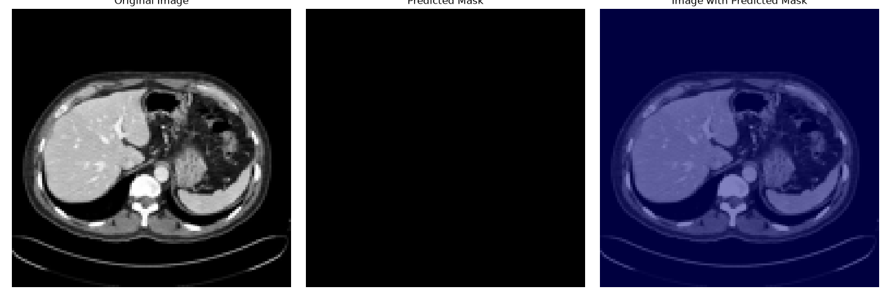
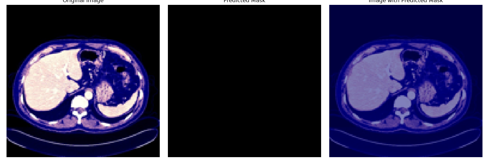

# Audit of the original code (commit `25dd2c7`)

Done on 2026-11-09 before the restructure: what was run, what worked, and what was broken.

## What was there

| File | Purpose |
|---|---|
| `app.py` | Flask: `/upload` runs the Keras model, saves matplotlib figures to `/tmp`; `/chat` calls OpenAI GPT-4o |
| `index.html` | Tailwind chat page that calls `http://127.0.0.1:5000` |
| `main.py` | Script: load model, segment one JPG, `plt.show()` |
| `jpeg.py` | Script: NIfTI volume to windowed JPG slices (needs fastai + PyTorch) |
| `liver-tumor-segmentation-with-different-tecniques.ipynb` | Kaggle training notebook |
| `liver_segmentation_model.h5` | Trained weights (49 MB) |
| `volume-101_slice_204.jpg` | Sample slice |

## Findings

### Runtime / code
1. **Uploads crash on Windows.** Files are written to the hard-coded `"/tmp"` directory and served from it.
2. **Chat is broken with any current `openai` package.** It uses `openai.ChatCompletion.create` and `openai.api_key`, which were removed in openai 1.0 (Nov 2023).
3. **The system prompt is never sent.** `prompt_template.format(...)` builds a prompt that is then not used; only the raw user text goes into `conversation_history`.
4. **Conversation history is a global** shared by all users and grows without bound.
5. Imports `langchain.prompts.PromptTemplate` and `skimage` just for string formatting / unused code, so they add heavy dependencies for nothing.
6. `main.py` and `jpeg.py` have hard-coded absolute macOS paths; `jpeg.py` needs fastai + PyTorch only for windowing.
7. No `requirements.txt`, no README (one line), no `.env.example`, no tests.
8. The UI loads avatar images from an external image host (`i.ibb.co`).

### Measurements reported to the user
9. **"Area (mm²)" is actually pixels at 128 x 128.** Contour areas are computed on the 128 x 128 network output and labelled mm²; there is no pixel spacing anywhere. Bounding boxes are also in 128 x 128 coordinates, not the uploaded image's.
10. The LLM prompt asks it to say whether "the scan possibly doesn't show any tumor" from the mask area, but **the model segments the liver, not tumours** (see below). This invites wrong medical claims.

### Model and notebook
11. **Which model is deployed:** the notebook trains three models (FCN, U-Net, SegNet), not VGG-16/19 or ResNet. The cell that writes `liver_segmentation_model.h5` saves `model2`, the **SegNet** (4.07 M parameters).
12. **It is a liver model, not a tumour model.** LiTS masks have 0 = background, 1 = liver, 2 = tumour. They were used as-is with a sigmoid output and binary cross-entropy, so liver and tumour are both pushed towards 1: the network learns *liver (including tumour)* vs background.
13. **Data leakage.** Slices from 65 random volumes were pooled and then split randomly *by slice* into 70/20/10 train/val/test, so neighbouring slices of the same patient are in both train and test.
14. **The reported metrics are not meaningful:**
    - U-Net and SegNet used a `dice_coefficient` computed along the last axis (one value per pixel, then averaged). Background pixels score 1, so the metric is ~0.99 even for poor masks. The U-Net is the clearest case: its loss and metric are frozen from epoch 1 (0.9884 every epoch), i.e. it collapsed to a constant output, yet it still "scores" 0.988.
    - The FCN used a global Dice (meaningful) but BCE on targets with value 2 gives negative loss values (`val_loss: -0.0010`).
    - No IoU was computed anywhere in the notebook, so the **0.9 IoU on the CV is not supported by the notebook**.
15. **The bundled sample slice has no liver in it.** `volume-101_slice_204.jpg` is a pelvic slice (bladder, iliac bones), displayed spine-up because of the `np.rot90` in the LiTS loader. The model (correctly) returns an empty mask on it, so the old demo's only sample could never show a segmentation.

### Running the original model the original way (2026-11-10)

To rule out any conversion or preprocessing mistake on our side, the original `app.py` and `index.html` were run unchanged (except pointing `/tmp` at a local folder) with the original `liver_segmentation_model.h5`, TensorFlow 2.18 + `tf-keras` (Keras 2, the version it was saved with), batch size 1. A clear liver slice from a public CT dataset (CHAOS, patient 2) was uploaded through the page's own upload function, once as a plain greyscale image and once in the notebook's 3-channel training format.

| Upload | Original app output |
|---|---|
| Greyscale (like an image from the web) |  |
| Notebook training format |  |

16. **Both predicted masks are completely empty.** The third panel looks like a blue "highlight", but it is matplotlib's `jet` colour map drawn over an all-zero mask, which tints the whole image. Together with the empty "Extracted Information" and a fluent GPT-4o answer (which never saw the image), this makes the old demo look like it worked when it did not.
17. The same result was found on 38 held-out liver slices, in 4 contrast windows and all 4 flip orientations: the model marks no liver pixels. A flat mid-grey image, on the other hand, gets probability 1.0 everywhere. The notebook's final SegNet score (per-pixel "dice" 0.9875 test) is even slightly *below* that of the collapsed U-Net that predicts all background (0.9878), consistent with a model that learned to output background. A plausible cause: the cell that saved the file ran after epoch 5, whose validation loss had jumped from 0.011 to 0.172; the better epoch-4 checkpoint went to `segnet_model2.h5` and was never used.

## What was done about it

See the README. In short: a clean package (`liverlenz/`, `app/`, `scripts/`), a provider-agnostic LLM client with an offline fallback, a new UI, and a **new model**. The goal of the project is tumour segmentation, so v2 is a two-stage U-Net (liver, then tumour inside the liver) trained on LiTS on a Kaggle GPU with binarised targets, Dice-based losses, a **patient-wise** split and held-out per-patient metrics ([`notebooks/train_lits_cascade.ipynb`](../notebooks/train_lits_cascade.ipynb)). The original SegNet weights were removed from the working tree; they remain in commit `25dd2c7`. The CHAOS images above are from Kavur et al., CHAOS challenge (Zenodo 3431873, CC BY-SA 4.0).
